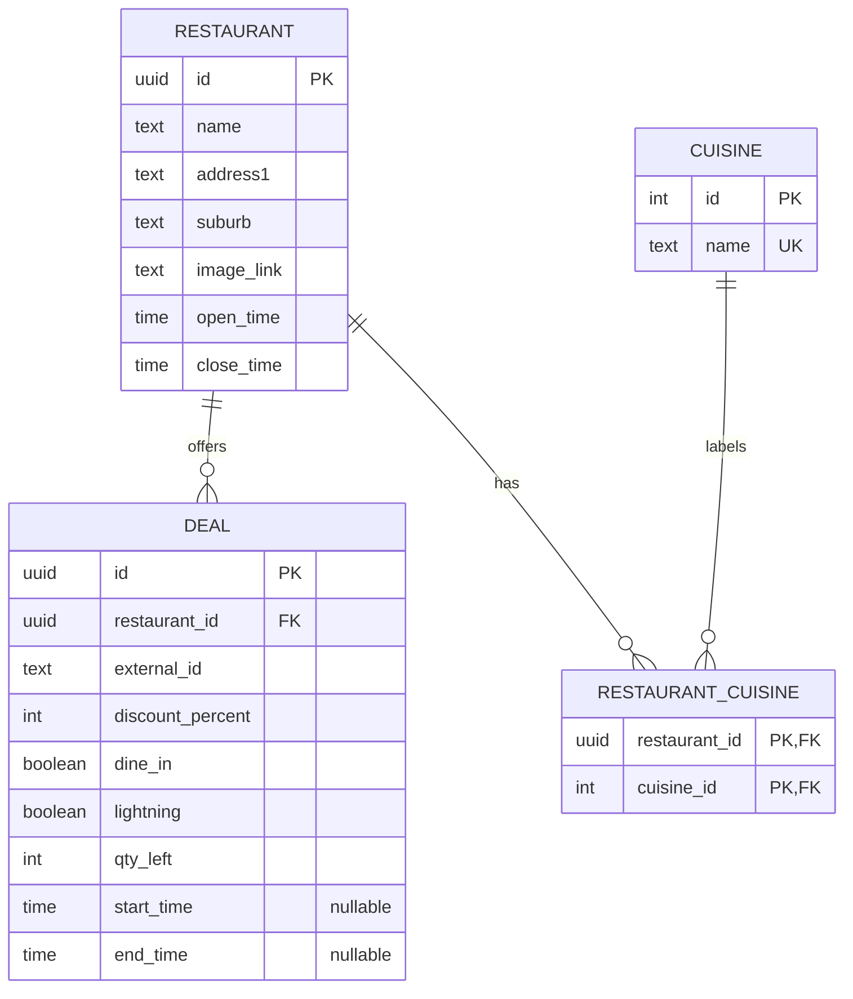

# Task 3: Database schema

## Database: PostgreSQL

I chose to use a PostgreSQL DB because:

The data is relational, ie one restaurant has many deals, a restaurant can have many cuisines and a cuisine can belong
to many restaurants. 

qty_left (how many instances of a specific deal are left) can have a race condition if 2 users try to obtain the deal
at the same time. PostgreSQL is ACID compliant, so it allows the decrement of qty_left to be one atomic statement
which keeps us safe from this race condition.

I am also comfortable using PostgreSQL and know that it is popular and well-supported. 

PostgreSQL itself can reject bad data by using foreign keys and typed columns.

## Decisions

- The source has `open`/`close` and `start`/`end` for deals, since no deal has both pairs I decided to collapse them in the
  db to `start_time` and `end_time`. Some deals have neither pair and for those we will leave `start_time` and `end_time` as null.
  When the application sees this it assumes that the deal uses the restaurant hours.

- I chose to use real types for the data, ie `time`,
  `int` and `boolean`. The source from https://eccdn.com.au/misc/challengedata.json sends them all as strings.

- Deals have their own key. The source has two deals with the same `objectId`.
  Because of this each deal has its own id for the PK. The source value is kept in `external_id`.

- Cuisines have their own table, and a join table links them to restaurants. 
  Each cuisine name is stored one time, and a search by cuisine can use an index.

## Indexes

- `deal(restaurant_id)` for the join from a restaurant to its deals.
- `restaurant(suburb)` for search by suburb.
- `restaurant_cuisine(cuisine_id)` for search by cuisine.